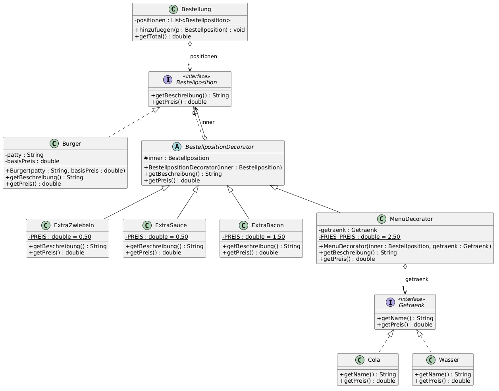
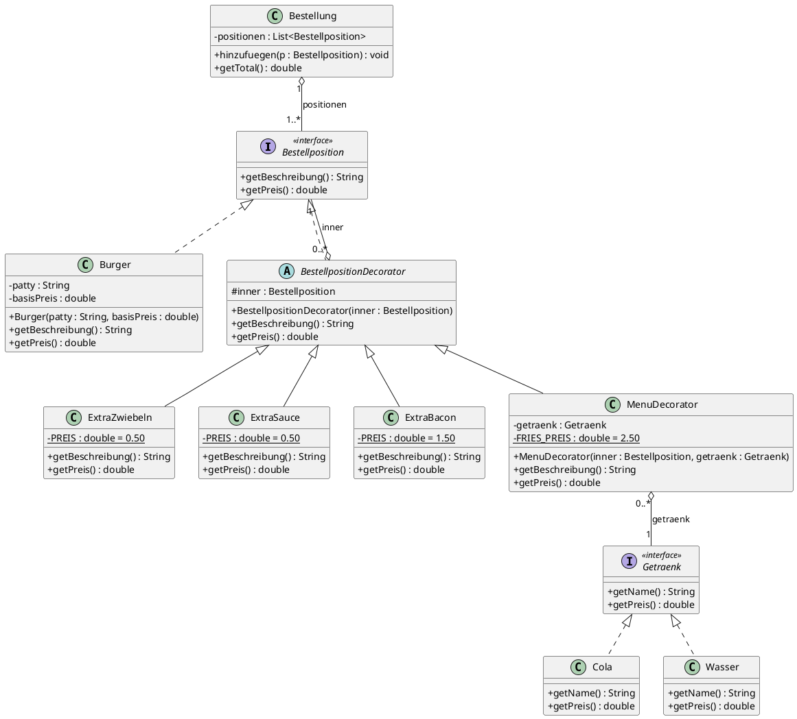

# KN-M3 – Lösung: Beschreibung B (Hamburger-Bestellung mit Decorator)

## 1. Analyse der Beschreibung

**Mögliche Klassen (Substantive):** Hamburger/Burger, Patty, Zutat (Zwiebeln, Sauce, Bacon), Menü, Getränk, French Fries, Bestellung.

**Was ist fix, was variabel?**

| Teil | Fix / variabel | Konsequenz |
|---|---|---|
| Burger mit Patty | fix (Basis jeder Bestellung) | konkrete Klasse `Burger` |
| Extra Zwiebeln, Sauce, Bacon, … | beliebig kombinierbar, später kommen neue dazu | **Decorator** (flexibel) |
| Menü (Getränk + Fries) | optional | ebenfalls Decorator |
| Getränk | Auswahl wechselt (Cola, Wasser, …) | **Interface** `Getraenk` |

**Warum keine Vererbung?** Mit reiner Vererbung bräuchte man für jede Kombination eine eigene Klasse: `BurgerMitBacon`, `BurgerMitBaconUndSauce`, `BurgerMitBaconSauceZwiebelnMenu`, … Bei *n* Extras sind das 2ⁿ Klassen (Klassenexplosion). Mit dem Decorator braucht man pro Extra genau **eine** Klasse und kombiniert sie zur Laufzeit.

## 2. Klassendiagramm (PlantUML)



PlantUML-Quellcode des Diagramms:



### Legende (Pfeile und Multiplizitäten)

| Symbol | Bedeutung | Im Diagramm |
|---|---|---|
| `<\|..` (gestrichelt, hohles Dreieck) | **IST-ein** durch *Interface-Realisierung* (`implements`) | `Burger`, `BestellpositionDecorator`, `Cola`, `Wasser` |
| `<\|--` (durchgezogen, hohles Dreieck) | **IST-ein** durch *Vererbung* (`extends`) | `ExtraBacon extends BestellpositionDecorator` usw. |
| `o--` (offene Raute, Linie ohne Pfeil, Multiplizitäten an beiden Enden) | **HAT-ein** (Aggregation, Teil kann auch ohne Ganzes existieren) | Decorator *hat* genau eine `Bestellposition` (`1`), eine `Bestellposition` kann von `0..*` Decorators umhüllt werden; `Bestellung` (`1`) hat `1..*` Positionen |

Multiplizitäten: `0..*` = null bis beliebig viele (0..n), `1..*` = mindestens eins bis beliebig viele (1..m), `1` = genau eins.

Der Kern des Decorators: `BestellpositionDecorator` **ist eine** `Bestellposition` *und* **hat eine** `Bestellposition`. Dadurch lassen sich Decorators beliebig ineinander verschachteln.

## 3. Starre Struktur vs. flexibles Design

* **Starr (Hierarchie):** `BestellpositionDecorator → ExtraBacon` usw. Die gemeinsame Basisklasse spart Code (Weiterleiten an `inner`), legt aber fest, dass jede Zutat ein Decorator ist.
* **Flexibel (Interfaces):**
  * `Bestellposition` – alle Teile der Bestellung (Burger, Burger+Extras, Menü) werden einheitlich behandelt. `Bestellung` kennt nur das Interface.
  * `Getraenk` – neues Getränk = neue Klasse, ohne `MenuDecorator` zu ändern.

## 4. Beispielcode (Java)

```java
public interface Bestellposition {
    String getBeschreibung();
    double getPreis();
}

public interface Getraenk {
    String getName();
    double getPreis();
}

public class Burger implements Bestellposition {
    private final String patty;
    private final double basisPreis;

    public Burger(String patty, double basisPreis) {
        this.patty = patty;
        this.basisPreis = basisPreis;
    }
    public String getBeschreibung() { return "Burger (" + patty + ")"; }
    public double getPreis()        { return basisPreis; }
}

public abstract class BestellpositionDecorator implements Bestellposition {
    protected final Bestellposition inner;

    protected BestellpositionDecorator(Bestellposition inner) { this.inner = inner; }

    public String getBeschreibung() { return inner.getBeschreibung(); }
    public double getPreis()        { return inner.getPreis(); }
}

public class ExtraBacon extends BestellpositionDecorator {
    private static final double PREIS = 1.50;
    public ExtraBacon(Bestellposition inner) { super(inner); }
    public String getBeschreibung() { return inner.getBeschreibung() + " + Extra Bacon"; }
    public double getPreis()        { return inner.getPreis() + PREIS; }
}
// ExtraZwiebeln und ExtraSauce analog

public class MenuDecorator extends BestellpositionDecorator {
    private static final double FRIES_PREIS = 2.50;
    private final Getraenk getraenk;

    public MenuDecorator(Bestellposition inner, Getraenk getraenk) {
        super(inner);
        this.getraenk = getraenk;
    }
    public String getBeschreibung() {
        return inner.getBeschreibung() + " + French Fries + " + getraenk.getName();
    }
    public double getPreis() { return inner.getPreis() + FRIES_PREIS + getraenk.getPreis(); }
}

// Verwendung
Bestellposition p = new MenuDecorator(
        new ExtraBacon(new ExtraSauce(new Burger("Beef", 8.90))),
        new Cola());
System.out.println(p.getBeschreibung() + " = CHF " + p.getPreis());
// Burger (Beef) + Extra Sauce + Extra Bacon + French Fries + Cola = CHF ...
```

## 5. Warum ist das wartbar und erweiterbar?

* **Neue Zutat** (z.B. Extra Käse): eine neue Klasse `ExtraKaese extends BestellpositionDecorator`. Es wird **kein bestehender Code geändert** (Open/Closed-Prinzip).
* **Neues Getränk:** neue Klasse, die `Getraenk` implementiert.
* **Neues Menü** (z.B. Kids-Menü): neuer Decorator.
* `Bestellung` und Preisberechnung bleiben unverändert, weil sie nur gegen das Interface `Bestellposition` programmieren.
* Kombinationen entstehen zur Laufzeit, es gibt keine Klassenexplosion.

---

## 6. Antworten auf die Fragen beim Gespräch

### Wieso sind Interfaces häufig besser als Vererbung?
* Eine Klasse kann **mehrere** Interfaces implementieren, aber nur **eine** Klasse erben.
* Interfaces beschreiben nur **Verhalten (Vertrag)**, nicht Implementierung. Dadurch entsteht eine **lose Kopplung**: Der Aufrufer kennt nur den Vertrag und kann die Implementierung austauschen (z.B. `Cola` ↔ `Wasser`).
* Vererbung koppelt Subklasse eng an die Basisklasse. Änderungen an der Basisklasse können alle Subklassen brechen (*fragile base class problem*).
* Vererbung ist starr: Das Verhalten wird zur Compile-Zeit festgelegt. Mit Interfaces und Komposition lässt es sich zur Laufzeit zusammensetzen („Composition over Inheritance").
* Bessere Testbarkeit: Interfaces lassen sich leicht durch Mocks ersetzen.

### Was bedeutet der Begriff „Deadly Diamond of Death"?
Das **Diamantproblem** der Mehrfachvererbung: Klasse `D` erbt von `B` und `C`, die beide von `A` erben.

```plantuml
@startuml
class A { + methode() }
class B
class C
class D
A <|-- B
A <|-- C
B <|-- D
C <|-- D
@enduml
```

Überschreiben `B` und `C` `methode()` unterschiedlich, ist unklar, welche Version `D` erbt (Mehrdeutigkeit). Zudem ist unklar, ob `D` ein oder zwei Exemplare von `A` enthält (z.B. in C++).
Java erlaubt deshalb **keine Mehrfachvererbung von Klassen**. Mehrere Interfaces sind erlaubt, weil sie (klassisch) keinen Zustand und keine Implementierung mitbringen. Bei `default`-Methoden mit gleicher Signatur muss die Klasse die Methode selbst überschreiben und kann mit `B.super.methode()` gezielt eine Version wählen.

### Wie stelle ich sicher, dass der Code flexibel erweitert werden kann?
* **Gegen Interfaces programmieren**, nicht gegen konkrete Klassen (`Bestellposition p`, nicht `ExtraBacon p`).
* **Komposition vor Vererbung** (Decorator, Strategy).
* **Open/Closed-Prinzip:** Erweitern durch neue Klassen statt bestehenden Code zu ändern.
* **Single Responsibility:** Jede Klasse hat genau eine Aufgabe (eine Zutat = eine Klasse).
* **Variierende Teile kapseln:** Alles, was sich ändern kann (Zutaten, Getränke, Zahlungsarten), hinter ein Interface legen.
* Keine Magic Numbers (Preise als Konstanten) und Tests gegen das Interface.
